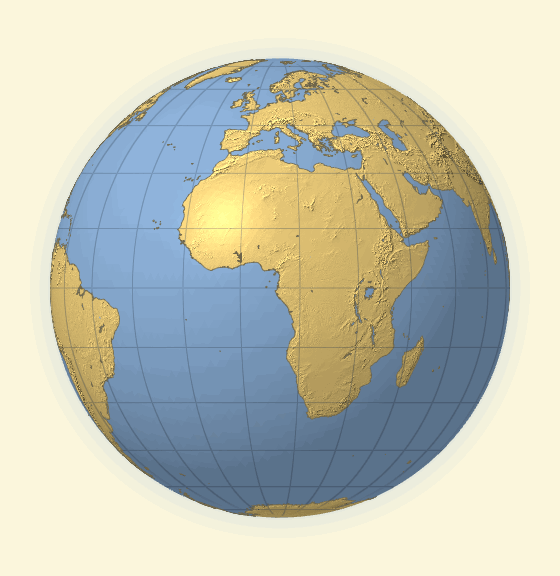
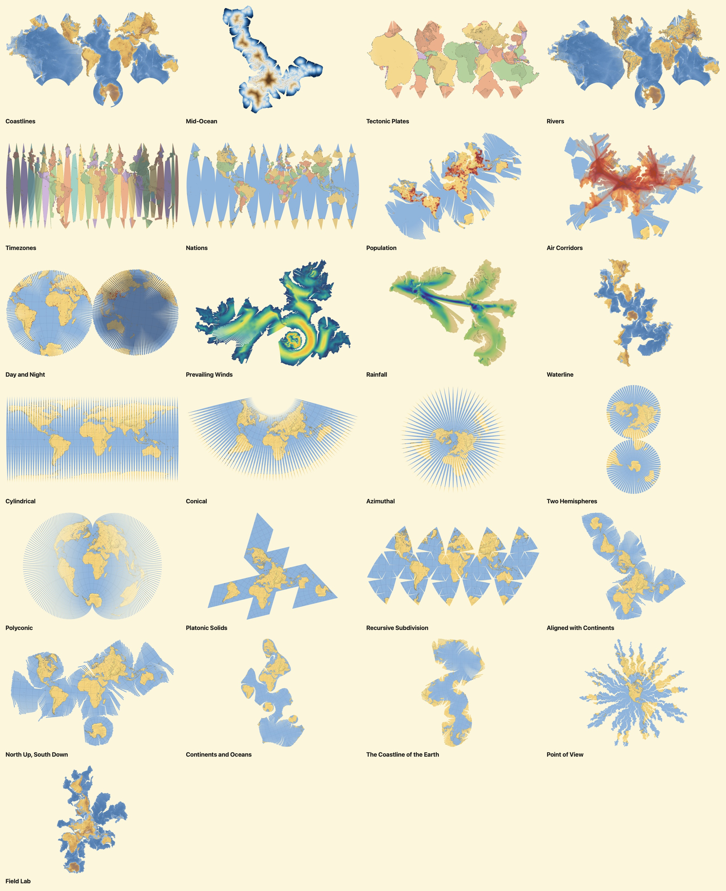
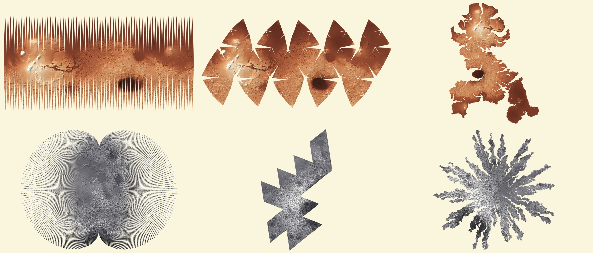
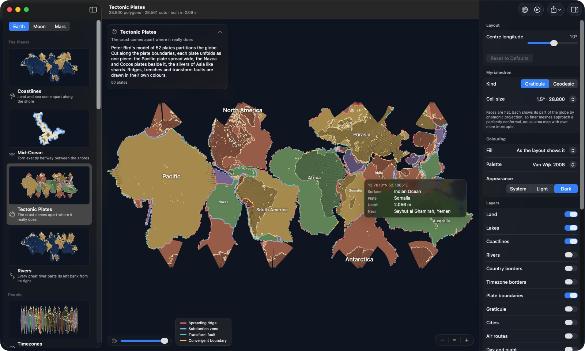
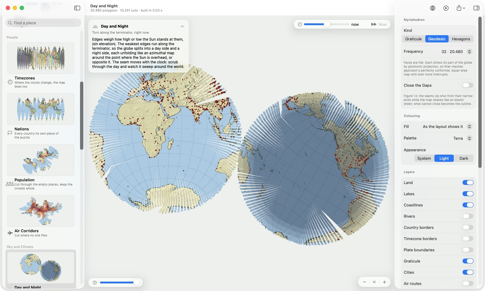
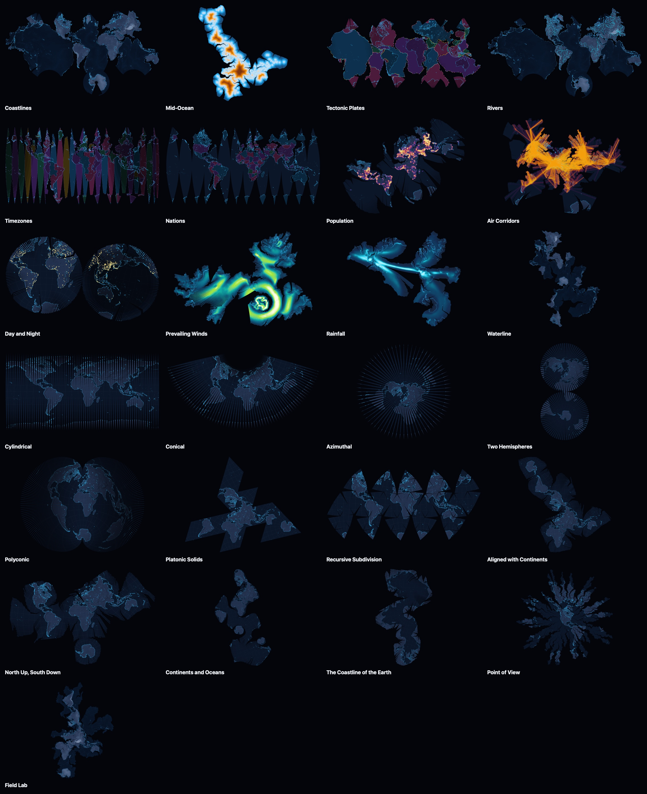

# JJ

The macOS app to play with the myriahedral projection of the Earth, and
of the Moon and Mars. A homage to Jarke J. van Wijk.



> *"A layman might wonder why map projection is a problem at all. A map of
> a small area, such as a district or city, is almost free of distortion.
> So, to obtain a map of the earth without distortion one just has to
> stitch together a large number of such small maps. In this article we
> explore what happens when this naive approach is pursued."*
> — Jarke J. van Wijk, *Unfolding the Earth: Myriahedral Projections*, 2008

## The idea

Van Wijk projects the globe onto a *myriahedron*, a polyhedron with a
myriad of faces, labels every edge a **fold** or a **cut**, and unfolds it.
The folds must form a spanning tree of the faces (the dual graph), and then
the cuts form a spanning tree of the mesh's vertices: exactly V − 1 of them.
Give every edge a weight, take the maximum spanning tree, and the weights
decide where the globe tears. *"Edges aligned with contours of w typically
turn into folds, whereas edges aligned with gradients of w turn into cuts."*

The resulting maps have many interrupts, but they are almost conformal and
conserve areas. Their gaps show, in plain sight, the distortion every
uninterrupted map hides.

JJ ("Jarke Jan") takes that machinery and asks what else the cuts can say.
In [myriamap](../myriamap), its predecessor, the seams followed the
timezones. In JJ, timezones are one layout among twenty-five. The planet
comes apart along its coastlines, rivers, plates, ocean middles and
waterlines. The human world comes apart along nations, crowds and air
routes. The sky comes apart along winds, rain and the line between day and
night. And all of van Wijk's own figures are redrawn, live, on today's GPUs.



## The layouts

| | Layout | The seams follow… |
|---|---|---|
| **The planet** | Coastlines | the shore: every land mass and each of the five oceans is its own piece |
| | Mid-Ocean | the ridges of the great-circle distance to the coast: the exact middles of the oceans (Point Nemo lies on a seam) |
| | Tectonic Plates | Peter Bird's 52 plate boundaries, drawn as ridges, trenches and transform faults |
| | Rivers | the great rivers: every river parts its left bank from its right |
| **People** | Timezones | the borders between clocks, with a live clock in every zone (myriamap's map) |
| | Nations | international borders; the open sea in 30° sectors |
| | Population | the empty places: the crowds stay whole |
| | Air Corridors | where no one flies: 60 000 airline routes hold the map together |
| **Sky and climate** | Day and Night | the terminator, right now; the map re-cuts as the clock moves |
| | Prevailing Winds | the wind: ribbons along the trade winds and westerlies, with drifting particles |
| | Rainfall | the dry world: the rain belts stay whole; step through the months to see the monsoon |
| **Shores and craters** | Waterline | the shore of a flooded world at any level: today's coast at 0 m, an ancient Martian ocean at −3.8 km |
| | Craters | the young plains (Moon and Mars): every named crater stays whole |
| **Van Wijk, 2008** | Cylindrical, Conical, Azimuthal, Two Hemispheres, Polyconic | the graticular weight w = −(W_φ\|φ − φ₀\| + W_λ min\|λ − λ₀ + 2πk\|) (figures 3 and 4) |
| | Platonic Solids | the oceans: each solid turned until its cuts cross the least land (figure 8) |
| | Recursive Subdivision | the self-similar cuts of subdivided solids with the w₀/w₁/w_c weights (figure 5) |
| | Aligned with Continents, North Up South Down, Continents and Oceans, The Coastline of the Earth | f, van Wijk's land density, a land raster convolved with a Gaussian on the sphere (figure 12) |
| | Point of View | the distance from a point, plus chance (figure 14) |

My own four additions to the user's list are **Prevailing Winds** (a nod to
van Wijk the flow visualiser), **Day and Night** (cuts that move in real
time), **Air Corridors** and **Nations**. Waterline and Craters came with
the other worlds.

## Other worlds

The same layouts that need no Earth data, and two that are new, unfold the
**Moon** (LRO LOLA topography, IAU feature names) and **Mars** (MGS MOLA
topography). On Mars, Waterline floods the northern lowlands to the
shoreline of the ocean that may once have been there.



## The app



- A gallery of every layout with live thumbnails, for the Earth, the Moon and Mars.
- Changing layout **folds the map back into the globe, swaps the cut while
  closed, and unfolds the new map** (every layout closes into the same
  globe, so the swap is invisible), the globe turning to its new centre.
  ⌘T tours the whole gallery this way.
- A time scrubber (±24 h) with a **time-lapse**: at an hour a second the
  Day and Night map re-cuts continuously and the timezone clocks race.
- Zoom with **⌘-scroll**, pinch, double-click or the **− = +** controls
  (⌘−, ⌘0, ⌘+); pan by dragging or scrolling; spin the globe when folded.
- **Find a place** (⌘F): where did Amsterdam go? The camera flies to wherever
  the unfolding put it and a marker pulses there; on the closed globe the
  globe turns to face it. Cities, countries and oceans on Earth; craters,
  maria and mountains on the Moon and Mars.
- Hover cards with whatever is under the pointer (country, clock, plate,
  height, rainfall, wind, the nearest city or crater); click to outline a
  piece; option-click (or the context menu) to recentre a layout on a place.
- An inspector generated from each layout's parameters, the mesh
  (graticules from 10° to 0.5°, geodesic spheres up to 327 680 triangles,
  hexagons: the dual of the geodesic sphere, up to 163 842 cells),
  any colouring (relief, any field, regions, the pieces of the cut), layers
  (coastlines, rivers, borders, plates, graticule, cities, air routes, night
  with civil, nautical and astronomical twilight, wind, cut edges, faces,
  Tissot's indicatrices, labels) and the statistics of the cut.
- Six palettes, each with a light and a dark variant: **Van Wijk 2008**
  (the yellow land and blue sea of the paper), **Atlas**, **Blueprint**,
  **Midnight**, **Ink** and **Terra**.
- Export to 4K or 8K PNG, an unfolding GIF, or the clipboard.





## Building

Everything needed comes with Xcode's command line tools.

```sh
./build.sh            # release build of dist/JJ.app (icon drawn by jj itself)
./build.sh --run      # … and open it
./build.sh --test     # run the tests first
swift run JJApp       # or straight from the package
```

The command-line tool renders any layout headless:

```sh
swift build -c release --product jj
.build/release/jj layouts
.build/release/jj render -l tectonic --palette atlas --dark -o plates.png
.build/release/jj render -l waterline --body mars -o mars.png
.build/release/jj render -l platonic -p solid=0 -o tetrahedron.png
.build/release/jj render -l rivers -m graticule:0.5 --width 8000 -o rivers.png
.build/release/jj animate -l geo-coastline -o unfold.gif
.build/release/jj gallery --palette midnight --dark --sheet sheet.jpg
.build/release/jj stats -l point-of-view
```

## How it works

1. **Myriahedra** (`MyriaCore`). Graticules (5° gives van Wijk's 2592
   polygons, 1° his 64 800), geodesic spheres (frequency 64: his 81 920
   triangles) and the five Platonic solids, recursively subdivided with his
   weight interpolation. Faces are flat; each shows its part of the sphere by
   gnomonic projection, so great circles stay straight inside a face.
   Polygons that are not planar become triangles of one *cell* whose
   interior edges are never cut: *"inserting interior edges with very high
   weights, such that these faces are never split up."*
2. **Data** (`MyriaData`). A `Body` is a catalogue of datasets and the
   fields derived from them, loaded lazily: polygons cut into tiles, line
   layers, points, and rasters in a small LZFSE-compressed grid format.
   Derived fields include van Wijk's f (a spherical Gaussian with his mask
   widths ⌈IL / 2J cos φ_j⌉, vectorised with vDSP), the exact signed distance
   to the coast (a k-d tree over the coastline), population and air-traffic
   densities, and crater density.
3. **Cuts** (`MyriaLayouts`). A layout combines weights (graticular,
   distance, fields, wind alignment, noise) or regions and returns a spanning
   tree. Region layouts (coastlines, plates, timezones, nations, rivers) use
   a region tree generalised from myriamap: polyconic strips inside each
   region, joined across borders by one hinge each, chosen near the equator
   and so that every piece hangs upright.
4. **Unfolding and folding.** A breadth-first walk over the hinges composes
   2D rigid motions, so hinged edges coincide exactly. Folding composes 3D
   hinge rotations, each closing by the same fraction of its dihedral angle
   (van Wijk's α′ = α(1 + cos πt/T)/2 is the animation's ease). A global
   rigid motion carries the root face from its place on the globe to the
   map's origin, which is why every layout closes into the same globe.
5. **Rendering** (`MyriaRender`). Faces live on the GPU in their own
   coordinates; one pose per face places them flat, folding or on the globe,
   so a frame of a fold costs one buffer write (under 1 ms for 81 920
   faces, subtrees posed in parallel). Relief, colour scales, the
   graticule and twilight are computed per pixel through the inverse
   gnomonic projection, so they stay exact at any zoom. Polygons (land,
   regions) are triangulated once per tile chunk with a Swift port of
   Mapbox's earcut and clipped to faces as convex triangles; lines are
   instanced quads with analytic antialiasing. Sub-pixel slits are sealed by
   dilating face edges by 0.6 px (switchable, for van Wijk's "transparency").

### Adding things

- **A layout**: conform to `Layout` (a descriptor with declarative
  parameters, and `cut(_:parameters:)` returning a spanning tree), append
  it to `LayoutCatalog.all`. The inspector builds its controls itself.
- **A palette**: a `Palette` with a light and a dark `PaletteStyle`,
  appended to `Palette.all`.
- **A world**: a `Body` with its resource folder, datasets and fields
  (see `Bodies.swift` for the Moon and Mars). Layouts appear for every body
  that has the data they need.

## Checked against the paper

The tests (`swift test`; 102 Swift Testing tests, over 200 cases with their
arguments) check the geometry,
the data and each layout's theme, and render maps with Metal to look at
the pixels:

- the polygon counts of figures 3, 4, 5 and 14, and van Wijk's subdivision
  weights (highest near the centres of the original edges);
- cuts form a spanning tree of the mesh graph, V − 1 edges, for all layouts;
- a high W_φ cuts along meridians, a high W_λ along parallels, a negative
  W_φ leaves two hemispheres hanging by exactly one hinge;
- *"For the tetrahedron a perfect … mapping is achieved"*: its optimal
  fold-out cuts no land at all; the icosahedron's cuts 0.1°;
- *"the value for the South Pole is similar to that of the centre of South
  America"* (f at σ = 10°);
- *"fold-overs are rare"*: overlaps cover well under 2 % of the map;
- **the maps conserve area**: painted land red and sea blue, the unfolded
  map's pixels reproduce the Earth's 29.2 % land share within 1.5 points;
- the closed map is a disc; palettes keep land, sea and neighbouring
  regions apart in both variants; snapshots of every layout stay put.

## Performance

On an M2: a 1.875° timezone map (18 432 faces) cuts and unfolds in 0.14 s;
81 920 faces in 0.18 s; a 0.5° graticule (259 200 faces) with land fills in
under 2 s. 259 200 faces fold in 4.4 ms per frame, 81 920 in under 1 ms: the fold plan
is stored depth first, so the trunk is posed first and every subtree then
on its own core, straight into a ring of GPU buffers. Drawing is a handful
of instanced draws; overlays the first frame of a new map needs are
prepared off the main thread.

## Layout

| Path | Contents |
|---|---|
| `Sources/MyriaCore` | vectors, myriahedra, topology, spanning trees (Kruskal and Prim), unfolding, folding, clipping, earcut, k-d tree |
| `Sources/MyriaData` | bodies, datasets, fields, GeoJSON, the grid format, bundled data for the Earth, the Moon and Mars |
| `Sources/MyriaLayouts` | the `Layout` protocol, the layout context, weights, the region tree, all layouts |
| `Sources/MyriaRender` | palettes, per-face overlays, the map engine, poses and cameras, the Metal renderer, export |
| `Sources/JJApp` | the SwiftUI app |
| `Sources/JJCommand` | `jj`, the command-line tool |
| `Sources/JJDataPrep` | `jj-data`, which downloads and prepares the data (`scripts/prepare-data.sh`) |

## Data and licences

See `Sources/MyriaData/Resources/*/SOURCES.md`. In short:

- Land, lakes, rivers, countries, cities: [Natural Earth](https://www.naturalearthdata.com), public domain.
- Timezones: [timezone-boundary-builder](https://github.com/evansiroky/timezone-boundary-builder) 2026e, © OpenStreetMap contributors, ODbL.
- Plates: P. Bird (2003), *An updated digital model of plate boundaries*, G³ 4(3); GeoJSON by H. Ahlenius, ODC-BY.
- Air routes: [OpenFlights](https://openflights.org/data), ODbL.
- Rainfall: GPCP v2.3 (Adler et al. 2018); winds: NCEP/NCAR Reanalysis 1 (Kalnay et al. 1996); both via NOAA PSL.
- Elevation: ETOPO1 (Amante & Eakins 2009, NOAA NCEI); the Moon: LRO LOLA; Mars: MGS MOLA (NASA PDS); feature names: the IAU Gazetteer of Planetary Nomenclature (USGS).

## Sources

- https://vanwijk.win.tue.nl/myriahedral/
- Jarke J. van Wijk, *Unfolding the Earth: Myriahedral Projections*,
  The Cartographic Journal 45(1), 32–42, 2008 (`CAJ103.pdf`). Henry Johns
  Award 2009.
